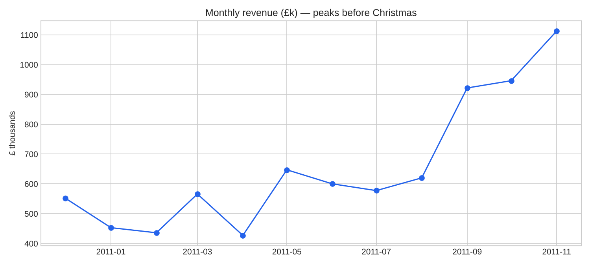
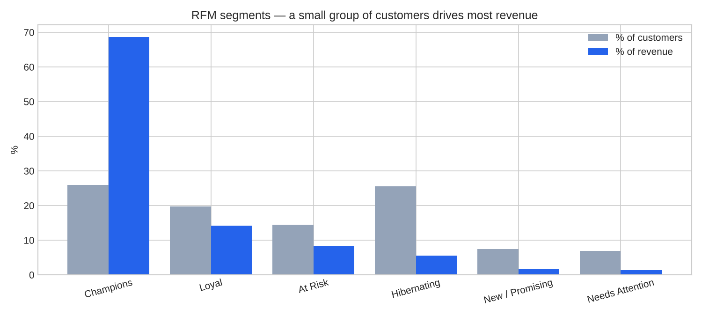
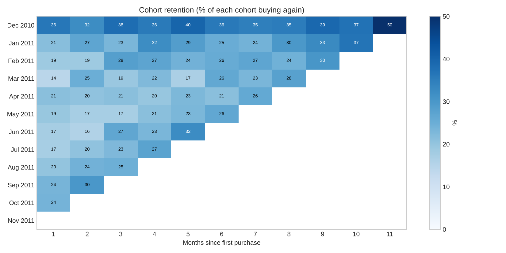

# UK Online Retail Analytics — SQL + Python

End-to-end analysis of **541,909 real transactions** from a UK-based online gift retailer (Dec 2010 – Dec 2011). I cleaned the data in SQL, built the KPIs a commercial team would track, segmented customers with **RFM** and measured **cohort retention**, then published the results as charts and an interactive dashboard.

**Tools:** SQL (DuckDB), Python (pandas, matplotlib, Plotly) · **Data:** [UCI Online Retail](https://archive.ics.uci.edu/dataset/352/online+retail)

---

## The business questions

1. How much does the business sell, to how many customers, and how is it trending?
2. Which customers matter most, and which ones are slipping away?
3. Do new customers come back, and how quickly?

## Key findings

| Metric | Value |
|---|---|
| Revenue (clean) | **£8.2m** |
| Orders | 18,162 |
| Customers | 4,321 |
| Average order value | £451 (mostly wholesale buyers) |
| Orders per customer | 4.2 |

- **Strong Q4 seasonality.** Revenue climbs from about £0.45m a month early in 2011 to **£1.11m in November**, so stock, staffing and marketing need to be in place by September.
- **26% of customers bring in 69% of revenue.** The "Champions" segment (bought recently and often) is worth £5.6m. Losing even a few of them would hurt more than losing all "Hibernating" customers combined.
- **614 "At Risk" customers (£0.7m)** used to buy often but haven't ordered for about 5 months on average. They are the cheapest win-back target.
- **About 1 in 5 new customers buys again the next month** (19.7% average across 2011 cohorts). The December 2010 cohort looks far better (36%), but only because the data starts that month: many of those "new" customers were really existing ones. I report it separately so it doesn't inflate the average.
- **82% of revenue is from the UK**, but the Netherlands produces £282k from just 9 customers, so a handful of key accounts deserve dedicated management.
- **Ordering happens Monday–Friday plus Sunday, peaking on Thursdays around midday**, with no Saturday orders in the data. That is useful for timing email campaigns and customer service cover.





Open `outputs/dashboard.html` in a browser for the interactive version.

## Data quality — what I cleaned and why

Raw data is never ready to use. Every rule in [`sql/01_clean.sql`](sql/01_clean.sql) is there because of a real problem in this file:

| Check | Rows |
|---|---|
| Raw rows | 541,909 |
| Missing customer ID (can't be used for customer analysis) | 135,080 |
| Cancellations / returns (invoice starts with `C`) | 9,288 |
| Zero or negative quantity / price | 11,805 |
| Orders reversed by a matching cancellation | 5,563 |
| **Clean sales rows** | **385,929** |

The most important catch: one customer ordered **80,995 units** of "Paper Craft, Little Birdie" and cancelled minutes later. Without removing reversed orders, that product would have topped the best-seller list. Postage and fee lines (`POST`, `M`, `BANK CHARGES` …) were also removed because they are not product sales.

## How it works

```
sql/01_clean.sql     load raw CSV, apply data-quality rules, build the clean `sales` table
sql/02_kpis.sql      headline KPIs, monthly trend, countries, top products, order timing
sql/03_rfm.sql       Recency / Frequency / Monetary scores (1–5 quintiles) and segments
sql/04_cohorts.sql   monthly acquisition cohorts and retention %
src/run_analysis.py  runs the SQL in order, exports CSVs, draws charts and the dashboard
```

**RFM in one line:** each customer gets a 1–5 score for how recently they bought, how often, and how much they spent; the score combinations map to segments such as *Champions* (recent and frequent) or *At Risk* (used to be frequent, now quiet).

**Cohorts in one line:** group customers by the month of their first purchase, then track what share of each group buys again in each following month.

The output CSVs in `outputs/` can be loaded straight into Power BI or Tableau.

## Run it yourself

```bash
pip install -r requirements.txt
python src/download_data.py   # fetches the ~45 MB dataset
python src/run_analysis.py
```

## What I'd do next

- Load the clean tables into Power BI and add filters by country and segment.
- Estimate customer lifetime value and test a win-back campaign on the At Risk segment.
- Forecast monthly demand for the Q4 peak.

---
*Data: Chen, D. (2015). Online Retail. UCI Machine Learning Repository. Licensed CC BY 4.0.*
